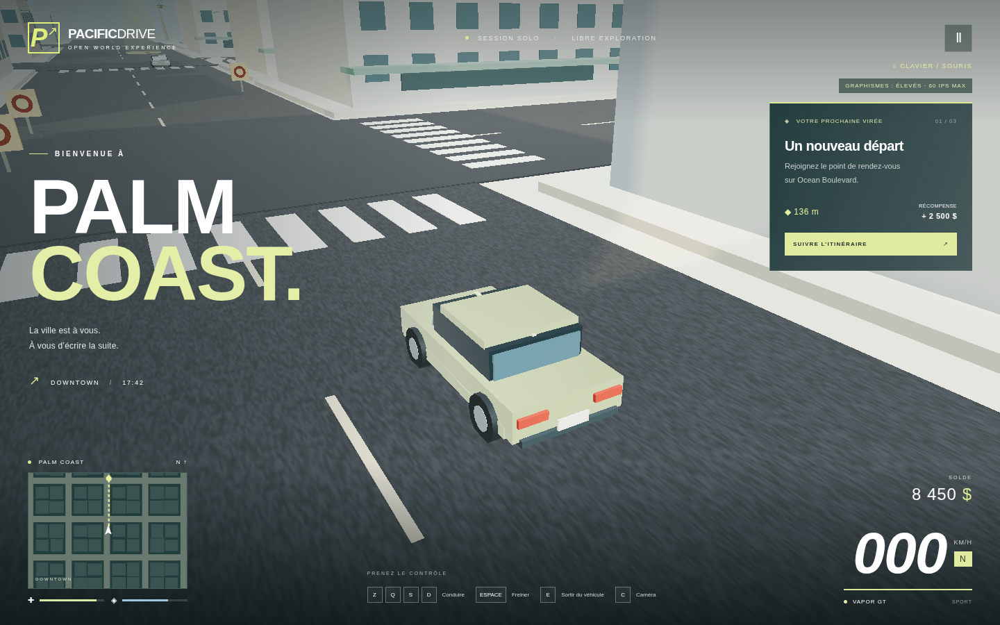
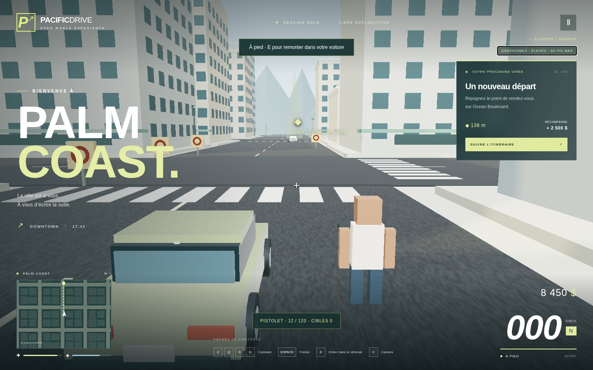
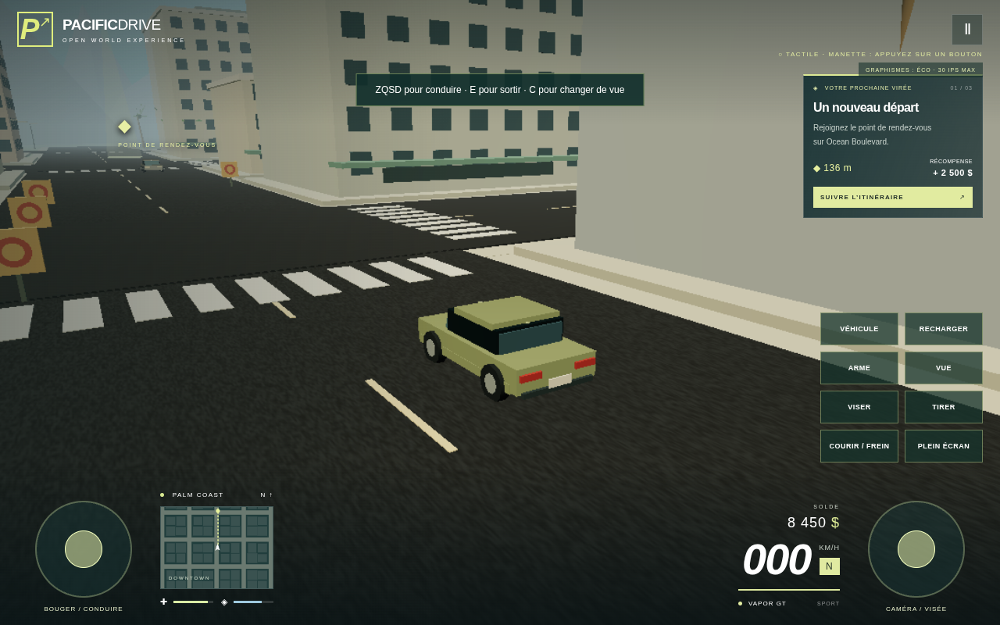

<div align="center">

# PACIFIC DRIVE
### Palm Coast est à vous.

Un prototype original de conduite et d’exploration en 3D, développé avec **Three.js**, **Electron** et **Capacitor**. Conduisez, explorez à pied et entraînez-vous au tir dans une ville côtière stylisée.

**[Android / Xiaomi Pad 7](https://github.com/azzoxMXYT/Grand-Three-Auto/releases/tag/v1.4.1)** · **[Windows](https://github.com/azzoxMXYT/Grand-Three-Auto/releases/tag/v1.3.0)** · **[Toutes les versions](https://github.com/azzoxMXYT/Grand-Three-Auto/releases)**



*Capture réelle du jeu dans Chromium, mode Élevé. Pas une image promotionnelle générée.*

</div>

## Le jeu en images

### Exploration à pied et armes



*Capture réelle du prototype sur ordinateur, mode Élevé. Pistolet, carabine et cibles d’entraînement sont utilisables à pied.*

### Version tablette



*Capture Chromium simulant une tablette 1280 × 800 en mode ÉCO. Ce n’est pas une capture prise sur une Xiaomi physique.*

## Télécharger et jouer

| Plateforme | Version | Fichier / démarrage |
| --- | --- | --- |
| **Android — Xiaomi Pad 7 et tablettes compatibles** | [v1.4.1](https://github.com/azzoxMXYT/Grand-Three-Auto/releases/tag/v1.4.1) | Télécharger `Pacific-Drive-1.4.1-Android-Test.apk`, l’ouvrir sur la tablette et suivre les instructions Android. Paysage, tactile et manettes. |
| **Windows 10/11 x64** | [v1.3.0](https://github.com/azzoxMXYT/Grand-Three-Auto/releases/tag/v1.3.0) | `Installation-x64.exe` pour installer avec raccourcis, ou `Portable-x64.exe` sans installation. |
| **Navigateur, ancienne version autonome** | [v1.1.0](https://github.com/azzoxMXYT/Grand-Three-Auto/releases/tag/v1.1.0) | Ouvrir `Pacific-Drive-Navigateur.html` avec Edge/Chrome. Cette ancienne version ne contient pas les dernières améliorations tactiles/manette. |

Les ressources sont embarquées dans les applications : pas de serveur, de compte ou de téléchargement supplémentaire nécessaire pour jouer après installation. Un fichier SHA-256 accompagne les applications pour vérifier leur intégrité ; ce n’est pas une signature d’éditeur.

> **Versions de développement :** les EXE Windows sont non signés et l’APK Android est débogable, signé avec une clé de test — pas une version Google Play. Defender, SmartScreen ou Play Protect peuvent avertir ou bloquer. **Ne désactivez pas ces protections et ne contournez pas une règle administrateur.** Une nouvelle compilation Android signée avec une autre clé de test peut nécessiter de désinstaller l’ancienne version.

## Ce que vous pouvez faire

- Parcourir une ville côtière procédurale : bâtiments, palmiers, enseignes, bord de mer et circulation simplifiée.
- Conduire la Vapor GT ou descendre pour explorer à pied.
- Rejoindre les balises jaunes : **2 500 $** par rendez-vous, trois destinations récurrentes.
- Alterner entre pistolet et carabine, viser, tirer et recharger.
- Détruire les cibles orange près de l’avenue de départ : trois impacts, **150 $**, réapparition après six secondes.
- Choisir le mode ÉCO ou Élevé et plusieurs vues en voiture.

**Périmètre :** prototype stylisé original, sans assets de GTA. Ce n’est pas un GTA V complet : pas de sauvegarde, multijoueur, intérieurs, audio, combat contre des PNJ ou dégâts aux véhicules. Le tir est disponible à pied seulement.

## 🎮 Jouer à la manette — Android et ordinateur

### Connexion sur Xiaomi Pad 7

1. Associez votre manette dans les réglages **Bluetooth** d’Android, ou connectez une manette USB reconnue avec un adaptateur adapté.
2. Ouvrez Pacific Drive et **appuyez sur un bouton** de la manette dans le jeu.
3. L’indicateur en haut à droite doit afficher **MANETTE CONNECTÉE**.
4. Le tactile reste disponible. Les entrées sont remises à zéro à la déconnexion ou à la perte de focus.

La v1.4.1 ajoute un **adaptateur Android natif** pour les contrôleurs reconnus par Android, en complément de l’API Gamepad de la WebView. Il transmet sticks, gâchettes et boutons au jeu sans permission Bluetooth spéciale : l’association reste gérée par Android.

Les dispositions Xbox et PlayStation ci-dessous sont des correspondances de boutons ; **tous les modèles, pilotes ou modes de connexion ne sont pas garantis**. Sur ordinateur/navigateur, un mapping Gamepad API `standard` reste nécessaire. Pas de vibration ni de remappage dans cette version.

| Action | Xbox | PlayStation |
| --- | --- | --- |
| Bouger à pied / tourner en voiture | Stick gauche | Stick gauche |
| Accélérer / reculer en voiture | RT / LT | R2 / L2 |
| Orienter la visée à pied | Stick droit | Stick droit |
| Tirer / rapprocher la visée à pied | RT / LT | R2 / L2 |
| Entrer / sortir du véhicule | Y | Triangle |
| Recharger | X | Carré |
| Changer d’arme | RB | R1 |
| Courir à pied / frein à main | A | Croix |
| Changer de vue en voiture | View / Select | Share / Create |
| Pause / reprendre | Menu / Start | Options |

**Dépannage :** vérifiez d’abord que la manette est reconnue dans Android, revenez au jeu et appuyez sur un bouton. Si rien ne se passe, indiquez le modèle exact de la manette, la version d’Android et le mode Bluetooth/USB. Ne confondez pas cette prise en charge avec une certification matérielle : aucun test avec manette physique ou Xiaomi Pad 7 réelle n’a été effectué ici.

## Commandes tactiles

- **Joystick gauche** : marcher ; en voiture, haut = accélérer, bas = reculer, gauche/droite = tourner.
- **Joystick droit** : orienter la visée à pied.
- **Véhicule**, **Arme**, **Recharger**, **Vue** : actions indiquées.
- Maintenir **Tirer**, **Viser**, **Courir / frein** pour l’action correspondante.
- Bouton pause en haut à droite ; plein écran selon le support du navigateur/WebView.

Deux doigts peuvent actionner les sticks simultanément. Relâchement, interruption tactile et changement d’application réinitialisent les entrées.

## Clavier et souris

| Action | Commande |
| --- | --- |
| Bouger / conduire | ZQSD, WASD ou flèches |
| Entrer / sortir du véhicule | E |
| Freiner | Espace |
| Courir à pied | Maj |
| Tirer à pied | Clic gauche |
| Viser à pied | Clic droit maintenu + souris |
| Recharger / replacer la voiture | R à pied / R en voiture |
| Changer d’arme | F |
| Changer de caméra | C |
| Pause | Échap |

## Graphismes et compatibilité

**ÉCO par défaut :** résolution interne plafonnée à 1280 × 720 et à 85 % de la fenêtre, sans ombres, MSAA ou génération de reflets d’environnement au lancement. Ciel et eau simplifiés, neuf véhicules de circulation, géométries statiques et véhicules regroupés. Interface à la résolution native.

**Élevé, activable manuellement :** ciel atmosphérique, eau animée, carrosserie vernie, vitres avec reflets d’environnement précalculés (pas des reflets temps réel de la ville), ombres, résolution jusqu’à 1,5×.

Plafonds : **30 images/s en ÉCO**, **60 en Élevé**, **10 en pause**. Ce sont des limites, pas des performances garanties. WebGL 2 et un pilote/WebView compatibles sont nécessaires. Android 7 minimum ; applications Windows x64. Le mode ÉCO vise notamment les circuits graphiques intégrés et la limitation de chauffe sur tablette, sans benchmark sur votre appareil.

## Développer et compiler

Prérequis web / Windows : **Node.js 22**, npm et Git.

```sh
git clone --branch arena/e83fd17f-grand-three-auto https://github.com/azzoxMXYT/Grand-Three-Auto.git
cd Grand-Three-Auto
npm ci
npm run dev
```

| Commande | Résultat |
| --- | --- |
| `npm test` | Tests unitaires des entrées, manettes, joysticks et limites de rendu |
| `npm run build` | Jeu web dans `dist/` |
| `npm run build:html` | Fichier HTML autonome dans `release/` |
| `npm run desktop` | Fenêtre Electron locale |
| `npm run dist:win` | Installateur et portable dans `release/` ; à lancer sur Windows |
| `npm run android:sync` | Compilation web et synchronisation Capacitor |

**Android :** JDK 21 et SDK Android 36, puis `npm run android:sync`, `cd android`, `./gradlew assembleDebug` (Windows : `gradlew.bat assembleDebug`). APK : `android/app/build/outputs/apk/debug/app-debug.apk`. Les clés de signature sont exclues de Git.

### Tests et captures reproductibles

Les workflows GitHub Actions compilent les applications. Playwright vérifie le rendu, les commandes tactiles simultanées, le tir, le changement d’arme, la pause et l’adaptateur manette Android simulé. La compilation Java vérifie le code natif ; elle ne remplace pas un essai Bluetooth/USB sur appareil.

Avec le serveur Vite lancé et Chromium installé (`npx playwright install chromium`) :

```sh
node scripts/browser-smoke.mjs
node scripts/tablet-smoke.mjs
node scripts/capture-game.mjs
```

Les images du README proviennent de `scripts/capture-game.mjs` et sont enregistrées dans `docs/screenshots/`. Les deux captures ordinateur utilisent le mode Élevé ; la capture tablette utilise le mode ÉCO. Aucun montage ni rendu généré hors du jeu.
